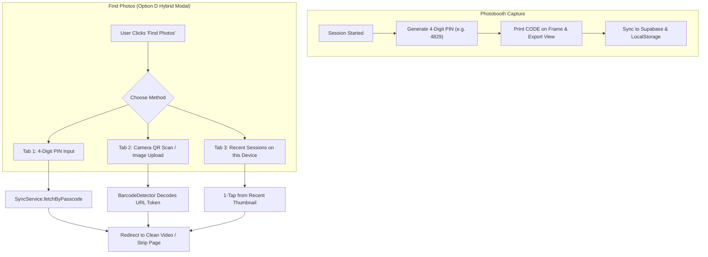

# Find Photos Hybrid Experience Implementation Plan

> **For agentic workers:** REQUIRED SUB-SKILL: Use superpowers:subagent-driven-development to implement this plan task-by-task. Steps use checkbox (`- [ ]`) syntax for tracking.

**Goal:** Transform the "Find Photos" feature from an unfriendly session ID input into an intuitive hybrid experience featuring a 4-digit photo passcode, in-browser QR camera/image scanner, and recent sessions gallery, completely removing technical IDs from the user interface.

**Architecture:**
- **Passcode Generation & Print:** Each booth session generates a human-friendly 4-digit code (e.g., `4829`) saved to the session state, printed directly on the photobooth strip footer alongside the QR badge, and stored in Supabase & local storage.
- **Recent Sessions History:** Completed sessions are saved to `localStorage` (`photobooth_recent_sessions`) with thumbnail previews, timestamps, and tokens for instant 1-tap retrieval.
- **In-Browser Scanner:** A camera/image scanner using native `BarcodeDetector` (with file upload fallback) decodes strip QR codes without third-party bloat.
- **Hybrid Retrieval Modal:** Replaces `SessionRetrieveModal.tsx` with a 3-tab studio interface: 4-Digit Passcode (default), Scan QR / Upload, and Recent Gallery. When found, it routes directly to the video/strip viewer.

**Architecture Diagram:**

**Tech Stack:** React 19, TypeScript, Tailwind CSS, Zustand, Supabase (with indexed `passcode` column), native Web `BarcodeDetector` API.

---

## Global Constraints

- Never ask the user for a raw `sessionId` or display database timestamps/internals.
- Zero external package additions (use native HTML5 `BarcodeDetector` and `<input type="file">` for QR scanning).
- All colors and styling strictly use `:root` CSS variables and the Hallmark / Anti-AI-Slop studio design system.
- Interactive elements must support instantaneous `:focus-visible` and transform-only animations (`active:scale-95`).
- Maintain 100% test coverage across all existing 15 test suites and add new tests for passcode resolution and recent history.

---

## Review Focus

1. **Passcode Collisions & Sorting:** When querying a 4-digit PIN in Supabase, ensure we sort by `created_at DESC` and match within recent time windows to avoid stale duplicate collisions.
2. **Camera Permissions & Cleanup:** Ensure camera scanner releases webcam tracks immediately on modal close.
3. **Offline / Localhost Fallback:** Recent sessions and in-memory cache must work completely offline without internet or Supabase.
4. **Mobile Responsive Touch Targets:** 4-digit inputs and buttons must be comfortable on touch screens (minimum 44x44px).
5. **No Backend Leaks:** Verify that searching by PIN or scanning returns only the clean video/strip token, with zero raw `session_` string exposed to the UI.

---

## Tasks

### Task 1: Add 4-Digit Passcode to Session State & Compositor Frame
- [ ] Add `passcode: string` (e.g., 4-digit random string `1000-9999`) to `BoothState` in `src/store/useBoothStore.ts`.
- [ ] Update `compositorService.ts` to draw `CODE: 4829` cleanly on the bottom footer of the physical photo strip next to the date and QR code.
- [ ] Update `ExportView.tsx` to display the 4-digit photo code prominently in the completion summary.
- [ ] Write unit test in `tests/boothStore.test.ts` and `tests/compositorService.test.ts` verifying passcode generation and canvas rendering.

### Task 2: Implement Passcode & Recent Sessions Storage in `SyncService`
- [ ] Update `SyncService.uploadSession` to accept `passcode` and persist it to the Supabase `booth_sessions` table (`passcode` column).
- [ ] Implement `SyncService.saveRecentSession(data)` storing the last 10 sessions in `localStorage` (`photobooth_recent_history`) with thumbnail, title, timestamp, and video token.
- [ ] Implement `SyncService.getRecentSessions()` reading from `localStorage`.
- [ ] Implement `SyncService.fetchByPasscode(pin: string)` querying local cache first, then Supabase by `passcode` ordered by `created_at DESC`.
- [ ] Write unit tests in `tests/syncService.test.ts` for passcode querying and recent session persistence.

### Task 3: Build Lightweight QR Scanner & Image Decoder Service
- [ ] Create `src/services/qrScannerService.ts`:
  - `scanFromVideo(videoElement: HTMLVideoElement): Promise<string | null>` using `window.BarcodeDetector`.
  - `scanFromImageFile(file: File): Promise<string | null>` using canvas + `BarcodeDetector` or fallback link reader.
- [ ] Gracefully handle environments where `BarcodeDetector` is unavailable by providing camera frame analysis and file input fallback.
- [ ] Write unit test in `tests/qrScannerService.test.ts`.

### Task 4: Rebuild `SessionRetrieveModal.tsx` into the Hybrid Experience
- [ ] Redesign `SessionRetrieveModal.tsx` into a high-aesthetic, tabbed Korean studio modal:
  - **Tab 1: 4-Digit Passcode**: 4 styled digit input boxes with auto-focus and auto-advance on keystroke, numeric keypad support on mobile, and instantaneous search.
  - **Tab 2: Scan QR / Photo**: In-modal camera viewfinder with scanning reticle, plus a "Upload Photo of Strip" button.
  - **Tab 3: Recent Photos**: Responsive grid of recent photobooth strips on this device with relative timestamps ("2m ago", "Today").
- [ ] Connect successful lookup to `onRetrieve(token, isVideo)` routing directly to `VideoViewerPage` or `StripViewerRoute` without exposing session IDs.
- [ ] Add clear loading states, tactile feedback (`sound.playClick()`), and human-friendly error messages ("No photos found for code 4829. Please double check the 4 digits printed on your strip").

### Task 5: Integration, End-to-End Verification, & Remote Deployment
- [ ] Wire the rebuilt modal in `src/App.tsx` and `src/components/showcase/HeroSection.tsx`.
- [ ] Run `npm test` to verify all existing and new unit/integration tests pass.
- [ ] Run `npm run build` (`tsc -b && vite build`) to confirm 0 compilation errors.
- [ ] Verify responsive layout across mobile and desktop.
- [ ] Commit and push changes to `main` branch on GitHub.
